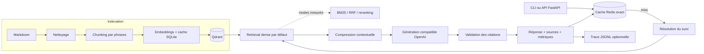

# Advanced RAG Knowledge Assistant

[](https://github.com/Slqzeer/Advanced-RAG-Knowledge-Assistant/actions/workflows/ci.yml)
[](https://www.python.org/)
[](LICENSE)

Assistant documentaire de production construit autour d'un pipeline RAG mesuré,
pas d'une démo opaque. Il ingère un corpus Markdown, compare plusieurs stratégies
de retrieval, compresse le contexte, génère une réponse sourcée, valide ses
citations et expose le tout par CLI ou API FastAPI.

Le corpus de référence est la documentation FastAPI. Les 30 étapes du projet sont
terminées : **653 tests passent**, la couverture de branches est de **95,79 %**, et
la régression retrieval est protégée dans GitHub Actions contre un corpus épinglé.

[Voir le dashboard](dashboard/index.html) · [Lire le plan et les résultats détaillés](docs/roadmap.md) · [Explorer les plans d'implémentation](docs/superpowers/plans/)

## Pourquoi ce projet

Ce dépôt montre comment construire puis évaluer un système RAG de bout en bout :

- ingestion, nettoyage et découpage reproductibles d'un corpus Markdown ;
- embeddings mis en cache et index vectoriel Qdrant ;
- recherche dense, BM25, fusion RRF, reranking et transformations de requête ;
- compression contextuelle avant génération ;
- réponses fondées avec citations validées et refus explicites ;
- évaluation du retrieval et des réponses, historique JSONL et dashboard hors ligne ;
- cache Redis exact, traces respectueuses de la vie privée et métriques agrégées ;
- API authentifiée, image non-root, Docker Compose et CI avec porte de régression.

Le principe directeur est simple : une option n'est activée que si elle passe une
règle écrite avant la mesure. Plusieurs techniques populaires sont donc présentes,
testées et volontairement désactivées parce qu'elles n'améliorent pas ce corpus.

## Architecture



Les registres internes rendent les variantes comparables sans coupler le pipeline
à un framework d'orchestration. Les valeurs par défaut viennent des expériences :
retrieval dense, chunking par phrases, compression par embeddings, sans reranker ni
transformation automatique de requête.

## Résultats mesurés

Toutes les lignes viennent des historiques versionnés dans [`data/eval/`](data/eval/).
Le [dashboard hors ligne](dashboard/index.html) présente les 64 runs sans embarquer
les questions, réponses ou sondes individuelles dans le navigateur.

| Expérience | Contrôle | Résultat | Décision |
|---|---:|---:|---|
| Chunking par phrases — Recall@5 | récursif 0,713 | **0,776** | activé |
| Hybrid RRF — Recall@5 / Recall@10 | dense 0,776 / 0,785 | 0,737 / **0,829** | désactivé : perte au rang 5 |
| FlashRank — Recall@5, p50 | 0,776, 35 ms | 0,779, **1 141 ms** | désactivé |
| Multi-query n=2 — Recall@5 / MRR | 0,776 / 0,810 | 0,765 / **0,867** | désactivé : règle non atteinte |
| Compression d'un vivier de 20 — Recall@context | 0,721 | **0,814** | activée |
| Compression — refus sur questions répondables | 0,316 | **0,211** | amélioré |
| RAGAS — relevancy | 0,649 | **0,705** | gain confirmé |
| Cache exact — hits et latence p50 | froid 2 622 ms | **30/30**, 19,8 ms | activé avec Redis |
| Observabilité — surcharge p95 | budget 2 ms | **0,84 ms** | activable |

Les résultats négatifs sont conservés : le reranking générique dégrade notamment la
catégorie `code`, le multi-query améliore le MRR mais pas le Recall@5, et le cache
sémantique n'a trouvé aucun seuil sûr sur sa fixture. Le détail, les règles
d'acceptation et les limites statistiques sont dans le [plan global](docs/roadmap.md).

## Démarrage rapide avec Docker

Prérequis : Docker avec Compose v2, une clé pour un fournisseur compatible OpenAI,
et Git.

```bash
git clone https://github.com/Slqzeer/Advanced-RAG-Knowledge-Assistant.git
cd Advanced-RAG-Knowledge-Assistant
cp .env.example .env
```

Renseigner au minimum dans `.env` :

```dotenv
OPENAI_API_KEY=sk-...
RAG_API_KEY=change-me
```

Construire les services, récupérer le corpus épinglé et créer l'index :

```bash
docker compose up --build -d --wait
docker compose exec rag-api python scripts/fetch_corpus.py
docker compose exec rag-api python scripts/index_corpus.py --recreate
```

Poser une question :

```bash
curl http://localhost:8000/query \
  -H "Content-Type: application/json" \
  -H "X-API-Key: change-me" \
  -d '{"question":"How does dependency injection work in FastAPI?"}'
```

La réponse contient le texte généré, les sources réellement citées, les statistiques
de retrieval, la latence, l'usage de tokens, les avertissements, le motif éventuel
de refus et la couche de cache utilisée. Swagger UI est disponible sur
`http://localhost:8000/docs`.

```bash
curl http://localhost:8000/health
curl http://localhost:8000/metrics
docker compose down
```

Les ports sont liés à `127.0.0.1`. Qdrant et les données applicatives utilisent des
volumes persistants ; Redis est volontairement éphémère.

## Développement local

Prérequis : Python 3.12, [`uv`](https://docs.astral.sh/uv/) et Docker.

```bash
uv sync --frozen
cp .env.example .env
docker compose up -d --wait qdrant redis
uv run python scripts/fetch_corpus.py
uv run python scripts/index_corpus.py --recreate
uv run python scripts/ask.py "How does dependency injection work in FastAPI?"
```

Le CLI expose aussi les variantes expérimentales :

```bash
# Filtrer une facette du corpus
uv run python scripts/ask.py "How do I test an endpoint?" --filter doc_type=tutorial

# Résoudre une question de suivi contre son historique
uv run python scripts/ask.py "And how do I override it?" \
  --history "How does dependency injection work?" \
  --history "Use Depends to declare a dependency [1]."

# Inspecter le contexte réellement envoyé au modèle
uv run python scripts/ask.py "How do dependencies work?" --show-context
```

Lancer l'API locale :

```bash
uv run uvicorn app.api.main:app --reload
```

## API

| Méthode | Route | Authentification | Rôle |
|---|---|---|---|
| `POST` | `/query` | `X-API-Key` | question, historique et filtres de métadonnées |
| `POST` | `/documents` | `X-API-Key` | ajout ou remplacement atomique d'un document |
| `GET` | `/health` | aucune | état de Qdrant et Redis |
| `GET` | `/metrics` | aucune | compteurs, latences, tokens et coût connu |

Exemple d'indexation :

```bash
curl http://localhost:8000/documents \
  -H "Content-Type: application/json" \
  -H "X-API-Key: change-me" \
  -d '{
    "document_id":"internal-001",
    "source":"internal/docs.md",
    "title":"Internal guide",
    "doc_type":"guide",
    "language":"en",
    "text":"# Internal guide\n\nThe service uses..."
  }'
```

Les modèles complets et les codes de réponse sont consultables dans l'OpenAPI généré
par FastAPI.

## Évaluation et dashboard

Le jeu principal contient 50 questions annotées, dont 5 réservées. Les métriques de
retrieval incluent Recall@K, Precision@K, MRR, Hit Rate, NDCG, catégories et latences.
Les réponses peuvent être jugées par RAGAS sur les contextes réellement transmis au
modèle.

```bash
# Valider les fixtures
uv run python scripts/validate_dataset.py

# Vérifier un candidat contre la baseline livrée sans modifier l'historique
uv run python scripts/benchmark.py \
  --label candidate --top-k 20 --compress embedding \
  --gate-against compress-embedding-d20 --no-save

# Reconstruire le snapshot du dashboard
uv run python scripts/build_dashboard.py
```

Le benchmark RAGAS effectue des appels payants et n'est jamais lancé par le pytest
par défaut. La CI protège plutôt une régression de retrieval déterministe contre le
corpus épinglé.

## Qualité

```bash
uv run ruff check .
uv run ruff format --check .
uv run mypy app
uv run pytest --cov=app --cov-branch
```

GitHub Actions exécute lint, formatage, mypy strict et la couverture de branches à
95 % sur les changements. Sur `main`, un second job reconstruit le corpus et l'index
Qdrant puis compare le retrieval à la baseline livrée.

## Configuration

[`.env.example`](.env.example) documente toutes les options. Les plus importantes :

| Variable | Défaut | Usage |
|---|---|---|
| `OPENAI_API_KEY` | vide | repli commun pour embeddings et génération |
| `GENERATION_BASE_URL` | OpenAI | passerelle compatible OpenAI optionnelle |
| `RAG_API_KEY` | vide | obligatoire pour les deux routes `POST` |
| `QDRANT_URL` | `http://localhost:6333` | index vectoriel |
| `REDIS_URL` | vide | active le cache exact |
| `CHUNK_STRATEGY` | `sentence` | stratégie promue par le benchmark |
| `RETRIEVAL_MODE` | `dense` | `dense`, `lexical` ou `hybrid` |
| `COMPRESS_METHOD` | `embedding` | compression contextuelle promue |
| `TRACE_PATH` | non défini | active les traces locales |
| `TRACE_CONTENT` | `false` | autorise prompt, contexte et réponse dans les traces |

Ne versionnez jamais `.env`. Par défaut, les traces n'existent pas ; si elles sont
activées, elles contiennent la requête utilisateur. Le contenu complet exige un
opt-in séparé.

## Limites connues

- Les chiffres publiés décrivent un seul corpus technique anglophone ; ils ne se
  généralisent pas automatiquement à un autre domaine.
- Les embeddings, la génération et RAGAS nécessitent des fournisseurs externes ;
  les coûts dépendent de leur tarification.
- Le cache sémantique, le reranking et le multi-query sont implémentés mais restent
  désactivés tant qu'ils ne passent pas leurs règles mesurées.
- L'API est prête à être conteneurisée, mais ce dépôt ne provisionne ni TLS, ni
  gestionnaire de secrets, ni plateforme de déploiement.
- Les métriques sont calculées depuis les traces locales ; ce n'est pas un backend
  de télémétrie distribué.

## Structure du dépôt

```text
app/
├── api/             # FastAPI et contrats HTTP
├── core/            # configuration partagée
├── evaluation/      # datasets, métriques, régression, RAGAS, dashboard
├── generation/      # contexte, compression, génération, citations, cache
├── ingestion/       # chargement, nettoyage, chunking, embeddings, indexation
├── models/          # modèles de données
├── observability/   # traces et métriques agrégées
└── retrieval/       # Qdrant, BM25, RRF, reranking, transformations
dashboard/           # rapport statique hors ligne
data/eval/           # fixtures et historiques de benchmark versionnés
docs/                # roadmap, décisions, spécifications et plans par étape
scripts/             # CLI d'exploitation et d'évaluation
tests/               # tests unitaires et intégrations locales
```

## Documentation

- [Plan global et registre des résultats](docs/roadmap.md)
- [Brief initial et parcours en 30 étapes](information.md)
- [Plans exécutables par étape](docs/superpowers/plans/)
- [Décisions et spécifications techniques](docs/superpowers/specs/)
- [Configuration complète](.env.example)
- [Dashboard de benchmark](dashboard/index.html)

## Licence

Distribué sous licence [MIT](LICENSE).
